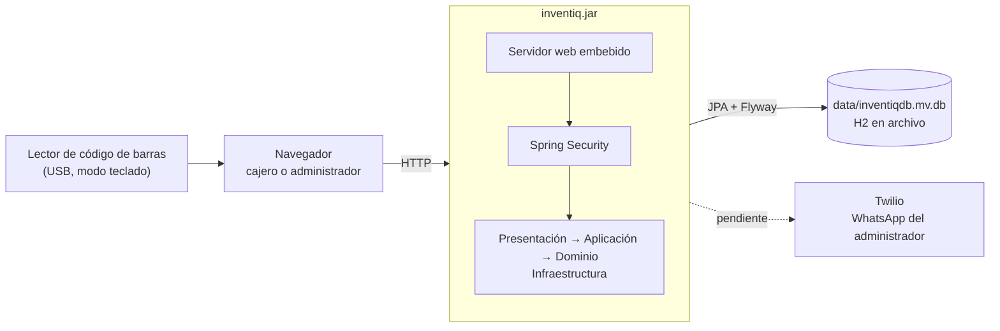
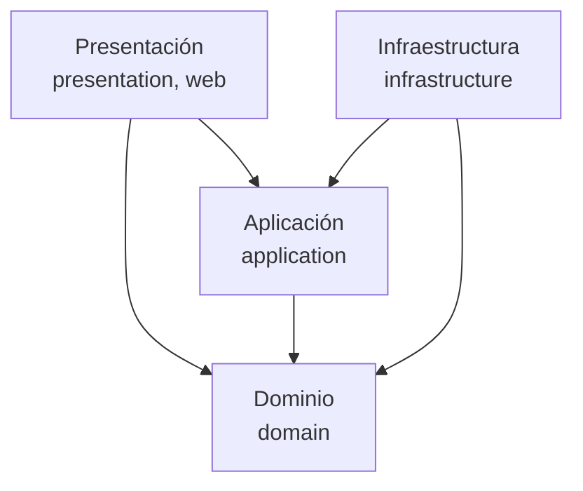
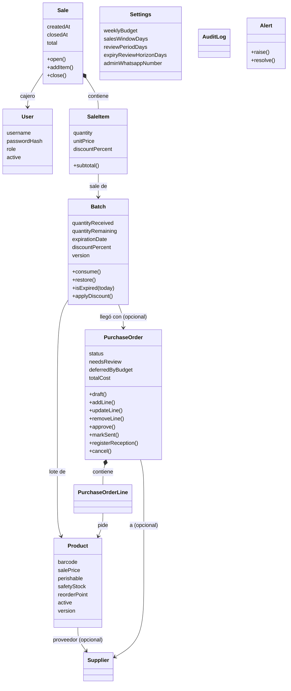
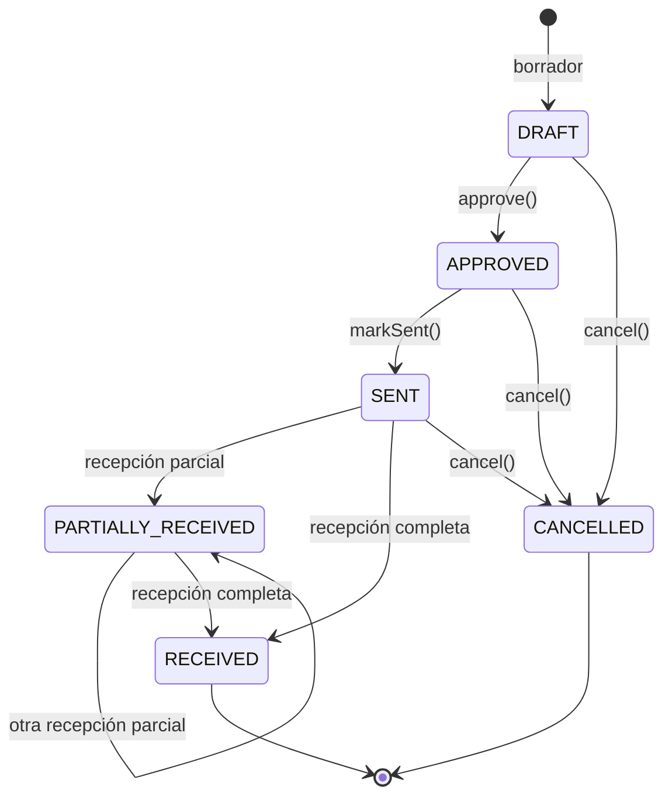
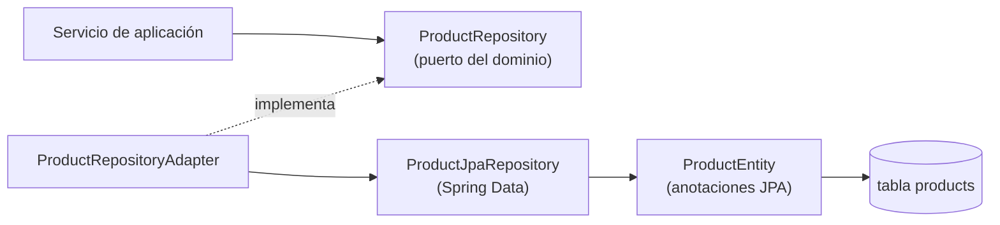
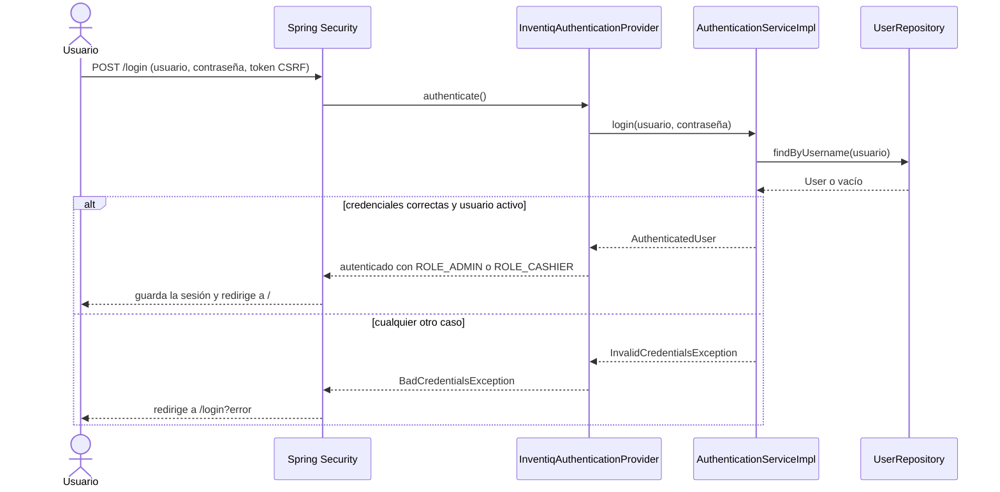
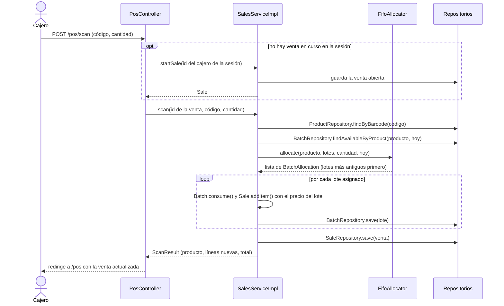

# Arquitectura de InventIQ

> **Estado:** Incremento 1 (versión 0.2). Este documento describe la arquitectura **tal como está construida** en `main`.
> La arquitectura planeada está en la Entrega 1; aquí se muestra cómo se llevó al código y qué falta.
> Las partes todavía en desarrollo están marcadas como _pendiente_.

Contenido:

1. [Visión general](#1-visión-general)
2. [Capas y regla de dependencias](#2-capas-y-regla-de-dependencias)
3. [Módulos: de lo planeado a lo construido](#3-módulos-de-lo-planeado-a-lo-construido)
4. [Modelo de dominio](#4-modelo-de-dominio)
5. [Puertos y adaptadores](#5-puertos-y-adaptadores)
6. [Persistencia](#6-persistencia)
7. [Seguridad](#7-seguridad)
8. [Recorrido de una venta](#8-recorrido-de-una-venta)
9. [Decisiones de arquitectura](#9-decisiones-de-arquitectura)
10. [Cómo se verifica la arquitectura](#10-cómo-se-verifica-la-arquitectura)
11. [Pendientes](#11-pendientes)

---

## 1. Visión general

InventIQ es un **monolito en capas** hecho con Spring Boot 4.1 y Java 21. Las pantallas son HTML generado en el servidor con Thymeleaf, y los datos se guardan en una base H2 embebida en un archivo. Todo se entrega como un solo archivo ejecutable, `inventiq.jar`, que solo necesita Java 21.

- **Un proceso, un archivo de base de datos.** No hay que instalar un servidor de base de datos ni un servidor web.
- **La base se crea al lado del JAR**, en la carpeta `data`. Flyway crea las tablas en el primer arranque.
- **El lector de código de barras no necesita controlador**: escribe el código como si fuera un teclado en el campo de la pantalla de ventas.
- **WhatsApp todavía no se envía**: los mensajes se escriben en el log (ver [sección 5](#5-puertos-y-adaptadores)).

---

## 2. Capas y regla de dependencias

El código está en el paquete `com.inventiq`, dividido en cuatro capas:

| Capa | Paquetes | Contiene | Puede usar |
| --- | --- | --- | --- |
| **Presentación** | `presentation`, `web` | Controladores, formularios y vistas Thymeleaf | Aplicación y modelo del dominio |
| **Aplicación** | `application` | Casos de uso: un servicio por módulo, que coordina el dominio y los repositorios | Dominio |
| **Dominio** | `domain` | Entidades, reglas de negocio y las interfaces (puertos) que necesita. Java puro | Nada fuera de sí mismo |
| **Infraestructura** | `infrastructure` | Tecnología: JPA, seguridad, notificador, configuración | Dominio y aplicación |

Las flechas indican "depende de". Lo importante es lo que **no** aparece:

- **El dominio no depende de nada.** No importa Spring, JPA, Hibernate ni Twilio, y no lee el reloj del sistema. Por eso sus reglas se prueban sin levantar Spring ni una base de datos.
- **Nadie depende de la infraestructura.** El dominio declara interfaces (por ejemplo `ProductRepository` o `MessageNotifier`) y la infraestructura las implementa. Spring conecta cada interfaz con su implementación al arrancar. Cambiar la base de datos o el proveedor de mensajes no obliga a tocar el dominio ni los servicios.
- **Nadie depende de la presentación.** Las pantallas se pueden cambiar sin afectar las reglas.

La infraestructura usa la aplicación en un único punto: `InventiqAuthenticationProvider` llama a `AuthenticationService` para verificar el login (ver [sección 7](#7-seguridad)).

**Sobre `web` y `presentation`:** los acuerdos del equipo nombran la capa `presentation`. La pantalla de ventas (Parte B) y la de reabastecimiento (Parte C) se hicieron en `web`, y el inicio de sesión en `presentation`. Las dos cuentan como capa de presentación y las reglas de arquitectura las tratan igual. Unificar el nombre está en [pendientes](#11-pendientes).

---

## 3. Módulos: de lo planeado a lo construido

| Módulo | Nombre | Paquetes | Estado |
| --- | --- | --- | --- |
| MOD-01 | Seguridad y acceso | `application.security`, `infrastructure.security`, `presentation.security` | Construido |
| MOD-02 | POS e inventario | `application.pos`, `domain.rules` (FIFO), `web.pos` | Construido |
| MOD-03 | Motor de reabastecimiento | `application.replenishment`, `domain.rules` (velocidad, ROP, MOQ, presupuesto), `web.replenishment` | Construido |
| MOD-04 | Vencimientos y precios | `application.pricing` | Contrato definido (`DiscountService`); implementación _pendiente_ |
| MOD-05 | Compras y administración | `application.purchasing` | Auditoría y alertas construidas; `PurchasingService` y pantallas _pendientes_ (Parte D) |
| MOD-06 | Infraestructura y despliegue | `infrastructure.persistence`, `infrastructure.messaging`, `infrastructure.config`, `db/migration` | Construido; adaptador de Twilio _pendiente_ |

Cada módulo atraviesa las capas: por ejemplo, MOD-02 tiene su pantalla en presentación, su servicio en aplicación y la regla FIFO en el dominio.

<!-- Parte D: actualizar la fila de MOD-05 cuando se fusione. -->

### Servicios de aplicación

| Servicio (interfaz) | Implementación | Módulo |
| --- | --- | --- |
| `AuthenticationService` | `AuthenticationServiceImpl` | MOD-01 |
| `SalesService` | `SalesServiceImpl` | MOD-02 |
| `ReplenishmentService` | `ReplenishmentServiceImpl` | MOD-03 |
| `DiscountService` | _pendiente_ | MOD-04 |
| `PurchasingService` | _pendiente_ (Parte D) | MOD-05 |

Los controladores solo conocen la interfaz del servicio. Así, cada parte del equipo pudo programar su pantalla contra un contrato acordado antes de que existiera la implementación.

---

## 4. Modelo de dominio

Las entidades están en `domain.model` y son clases Java normales, sin anotaciones de JPA.

### Agregados

Dos grupos de objetos se guardan y se modifican siempre juntos, a través de su objeto raíz:

- **`Sale` + `SaleItem`**: los ítems solo se agregan con `Sale.addItem()`, y una venta cerrada no se modifica. `SaleItem` guarda el precio ya con descuento y el porcentaje aplicado, para que el historial no cambie si el precio cambia después.
- **`PurchaseOrder` + `PurchaseOrderLine`**: las líneas solo se agregan, cambian o quitan a través del pedido (`addLine`, `updateLine`, `removeLine`), que valida que su estado lo permita y recalcula el costo total. Un pedido sin proveedor queda marcado "por revisar" (`needsReview`), y uno que no cabe en el presupuesto queda marcado como aplazado (`deferredByBudget`).

Otros detalles del modelo:

- **`Product`** puede no tener proveedor (`supplierId` vacío); el sistema lo señala con una alerta. Guarda su punto de reorden y su stock de seguridad.
- **`Batch`** (lote) guarda cuántas unidades llegaron y cuántas quedan, la fecha de vencimiento (vacía si el producto no es perecedero), el descuento vigente del lote y, si llegó con un pedido, de cuál.

Los cambios de estado de un pedido los controla la propia entidad:

### Otras entidades

- **`Settings`**: una sola fila (id 1) con los parámetros del negocio: presupuesto semanal, ventanas de cálculo y número de WhatsApp del administrador. La crea la migración `V2`.
- **`AuditLog`**: registro de decisiones automáticas y manuales (`AuditAction`), por ejemplo el recálculo de un ROP o la aprobación de un pedido.
- **`Alert`**: avisos para el administrador (`AlertType`), por ejemplo stock bajo o un producto sin proveedor.

### Reglas de negocio puras (`domain.rules`)

| Regla | Clase | Qué calcula |
| --- | --- | --- |
| FIFO | `FifoAllocator` → `BatchAllocation` | De qué lotes salen las unidades vendidas: primero los más antiguos |
| Velocidad de ventas | `SalesVelocityCalculator` | Unidades vendidas por día en la ventana configurada |
| Punto de reorden | `ReorderPointCalculator` | El nivel de stock que dispara una sugerencia de compra |
| Pedido mínimo | `MoqCompletion` (`MoqCandidate` → `MoqCompletionResult`, `MoqSuggestion`) | Qué productos agregar para alcanzar el mínimo del proveedor |
| Presupuesto | `BudgetPrioritizer` (`BudgetCandidate` → `BudgetAllocation`) | Qué pedidos caben en el presupuesto semanal y cuáles se aplazan |

Estas clases reciben datos y devuelven resultados, sin guardar nada ni consultar la base. Los servicios de aplicación les pasan los datos y guardan los resultados.

### Errores y fechas

- **Errores de negocio**: heredan de `DomainException` (`UnknownBarcodeException`, `InsufficientStockException`, `InvalidSaleException`, `InvalidCredentialsException`). Su mensaje está en español y la pantalla lo muestra tal cual, sin interrumpir lo que el usuario estaba haciendo.
- **Fechas**: el dominio nunca lee la fecha del sistema. Recibe la fecha como parámetro (por ejemplo `Batch.isExpired(today)` o `Sale.open(cashierId, now)`); los servicios la obtienen de un `Clock` que provee `ClockConfig`, con la zona horaria `America/Bogota`. Así las reglas que dependen del tiempo (vencimientos, ventanas de ventas) se prueban con fechas fijas.

---

## 5. Puertos y adaptadores

Un **puerto** es una interfaz que el dominio declara en `domain.port`, y un **adaptador** es la clase que la implementa con una tecnología concreta.

| Puerto | Implementación | Ubicación |
| --- | --- | --- |
| `UserRepository`, `SupplierRepository`, `ProductRepository`, `BatchRepository`, `SaleRepository`, `PurchaseOrderRepository`, `SettingsRepository`, `AuditLogRepository`, `AlertRepository` | `<Nombre>RepositoryAdapter` | `infrastructure.persistence.adapter` |
| `MessageNotifier` | `LoggingMessageNotifier` (con `inventiq.notifier=log`, el valor por defecto) | `infrastructure.messaging` |
| `MessageNotifier` | Adaptador de Twilio (con `inventiq.notifier=twilio`) | _pendiente_ |
| `AuditRecorder` | `DatabaseAuditRecorder` | `application.purchasing` |
| `AlertService` | `DatabaseAlertService` | `application.purchasing` |

- **`MessageNotifier`** devuelve un `NotificationResult` y nunca lanza excepciones: si un envío falla, el sistema sigue funcionando y queda registrado. `LoggingMessageNotifier` escribe el mensaje en el log con la etiqueta `[WhatsApp simulado]` y oculta parte del número. Cuando exista el adaptador de Twilio, se activará cambiando una propiedad, sin tocar el código que envía mensajes.
- **`AuditRecorder` y `AlertService`** se implementan en la capa de aplicación porque no usan ninguna tecnología: solo combinan repositorios del dominio.
- **Para las pruebas** hay versiones en memoria de cada repositorio (`src/test/java/com/inventiq/fakes`, por ejemplo `InMemoryProductRepository`). Los servicios se prueban con ellas, sin base de datos.

---

## 6. Persistencia

### Patrón entidad / repositorio JPA / adaptador

El modelo del dominio y las tablas están separados por tres clases por cada entidad:

- **`<Nombre>Entity`** (`infrastructure.persistence.entity`): la clase con anotaciones JPA que corresponde a la tabla. Convierte desde y hacia el modelo con `fromDomain` y `toDomain`.
- **`<Nombre>JpaRepository`** (`infrastructure.persistence.jpa`): la interfaz de Spring Data que hace las consultas.
- **`<Nombre>RepositoryAdapter`** (`infrastructure.persistence.adapter`): implementa el puerto del dominio usando las dos anteriores.

Los agregados se guardan completos: al guardar un `PurchaseOrder` se guardan sus líneas, y una línea quitada del pedido se borra de la tabla.

### Esquema y migraciones

- **Flyway** crea y actualiza el esquema con los scripts de `src/main/resources/db/migration`:
  - `V1__esquema_inicial.sql`: las tablas `users`, `suppliers`, `products`, `batches`, `sales`, `sale_items`, `purchase_orders`, `purchase_order_lines`, `settings`, `audit_logs` y `alerts`.
  - `V2__configuracion_inicial.sql`: la fila única de `settings` con valores iniciales.
- **Una migración fusionada no se edita nunca.** Cualquier cambio de esquema es una migración nueva (`V3`, `V4`, ...).
- **Hibernate solo valida** (`spring.jpa.hibernate.ddl-auto=validate`): comprueba al arrancar que las entidades coinciden con las tablas, pero nunca las modifica. Un desajuste se detecta al arrancar y no en producción.
- **Los enums se guardan como texto** (`VARCHAR`), no como números, para que agregar un valor nuevo no altere los datos existentes.
- **`Product` y `Batch` tienen columna `version`** (bloqueo optimista): si dos ventas modifican el mismo lote al mismo tiempo, la segunda falla en vez de descontar mal el inventario.

### Perfiles

| Perfil | Base de datos | Uso |
| --- | --- | --- |
| _(por defecto)_ | `data/inventiqdb` (archivo) | Desarrollo e instalación en la tienda |
| `demo` | `data/inventiq-demo` (archivo aparte) | Presentaciones: carga además `db/demo/R__datos_demo.sql` con datos de ejemplo |
| `test` | En memoria | Pruebas automáticas; se activa solo al ejecutar las pruebas |

El script demo es "repetible" (`R__`): Flyway lo vuelve a aplicar cada vez que cambia. Nunca se guarda en `db/migration`, para que los datos de ejemplo no lleguen a una instalación real.

---

## 7. Seguridad

### Componentes

| Clase | Capa | Responsabilidad |
| --- | --- | --- |
| `SecurityConfig` | Infraestructura | Reglas de acceso por ruta, login, logout y CSRF |
| `InventiqAuthenticationProvider` | Infraestructura | Conecta el formulario de login de Spring Security con `AuthenticationService` |
| `AuthenticationServiceImpl` | Aplicación | Verifica usuario, contraseña y que el usuario esté activo |
| `PasswordEncoderConfig` | Infraestructura | Define BCrypt como algoritmo de contraseñas |
| `InitialUsers` | Infraestructura | Crea `admin` y `cajero` al arrancar si no existen |
| `LoginController`, `HomeController` | Presentación | Página de login y redirección de `/` a `/pos` |
| `AuthenticatedUser` | Aplicación | El usuario guardado en la sesión: id, nombre y rol |

### Reglas de acceso

| Ruta | Sin sesión | Cajero | Administrador |
| --- | --- | --- | --- |
| `/login` | Sí | Sí | Sí |
| `/` | Al login | Redirige a `/pos` | Redirige a `/pos` |
| `/pos/**` | Al login | Sí | Sí |
| Cualquier otra (`/replenishment`, `/h2-console`, pantallas futuras) | Al login | No (403) | Sí |

La última fila es **cerrada por defecto**: una pantalla nueva queda solo para el administrador sin que nadie tenga que acordarse de protegerla. Para abrirla al cajero hay que agregarla explícitamente en `SecurityConfig`.

### Inicio de sesión

- **Una sola lógica de login**: Spring Security maneja la sesión, la cookie y el CSRF, pero la verificación la hace siempre `AuthenticationService`, que es parte del contrato del equipo.
- **El usuario de la sesión es un `AuthenticatedUser`**: los controladores obtienen de ahí el id de quien está trabajando. Así, cada venta queda a nombre del cajero que la hizo.
- **No se revela qué usuarios existen**: un usuario inexistente, una contraseña incorrecta y un usuario inactivo reciben el mismo mensaje. Cuando el usuario no existe, igual se ejecuta una comparación BCrypt para que el tiempo de respuesta tampoco lo delate.
- **Contraseñas con hash BCrypt**: en la base nunca está la contraseña en texto.
- **Usuarios iniciales**: `InitialUsers` crea `admin` y `cajero` al arrancar, solo si no existen, y nunca modifica uno existente. Las contraseñas vienen de `application.properties` y en una instalación real se definen con las variables de entorno `INVENTIQ_INITIALUSERS_ADMINPASSWORD` e `INVENTIQ_INITIALUSERS_CASHIERPASSWORD`.
- **CSRF**: todo formulario que envía datos (`POST`) lleva un token que Thymeleaf agrega solo cuando se usa `th:action`. Sin el token, la petición se rechaza. Esto impide que otra página web haga acciones a nombre del usuario.
- **Consola de H2**: solo para el administrador, y se puede desactivar con `--spring.h2.console.enabled=false`.

---

## 8. Recorrido de una venta

Este caso muestra cómo una acción del cajero atraviesa todas las capas.

- **El controlador no tiene reglas de negocio**: recibe el formulario, llama al servicio y muestra el resultado. Si el servicio lanza una `DomainException` (código desconocido, stock insuficiente), el controlador muestra el mensaje y la venta en curso sigue intacta.
- **El servicio coordina**: valida la cantidad, comprueba que la venta exista y siga abierta, busca los datos con los repositorios, le pide la decisión a la regla pura (`FifoAllocator`) y guarda el resultado. Un código inexistente o de un producto inactivo lanza `UnknownBarcodeException` sin tocar nada.
- **La regla decide**: `FifoAllocator` no sabe de bases de datos ni de pantallas. Si no alcanza el stock, lanza `InsufficientStockException`.
- **Una línea por lote**: si las unidades salen de dos lotes, la venta tiene dos líneas, cada una con el precio y el descuento de su lote.
- **Todo o nada**: cada operación del servicio es una transacción (`@Transactional`). Si algo falla a mitad de un escaneo, no queda ningún lote descontado ni ninguna línea guardada.
- **Cada acción termina en una redirección** a `/pos`, así recargar la página nunca repite un escaneo.
- **Terminar** (`/pos/finish`) cierra la venta; no se puede terminar una venta sin productos. **Cancelar** (`/pos/cancel`) devuelve las unidades a los mismos lotes de donde salieron y borra la venta.

El detalle de la Parte B está en [`parte-b-ventas.md`](parte-b-ventas.md).

---

## 9. Decisiones de arquitectura

| # | Decisión | Por qué | Costo aceptado |
| --- | --- | --- | --- |
| D1 | Monolito en capas con MVC | Un solo despliegue, simple de instalar y de desarrollar para un equipo de 4 | No se puede escalar cada parte por separado; aceptable para tiendas de una sola sucursal |
| D2 | Dominio puro con puertos | Las reglas de negocio se prueban sin Spring ni base de datos, y no dependen de la tecnología | Hay que escribir interfaces y conectarlas |
| D3 | Entidades JPA separadas del modelo | El dominio queda libre de anotaciones y de las restricciones de JPA | Código de conversión (`fromDomain`, `toDomain`) por cada entidad |
| D4 | H2 en archivo con migraciones Flyway | Nada que instalar; el esquema queda versionado y es igual en todos los computadores | H2 no sirve para muchos usuarios simultáneos; cambiar de motor requeriría revisar los scripts |
| D5 | Notificador detrás de una interfaz, simulado por defecto | Se desarrolla y se prueba sin credenciales de Twilio; activar el real es cambiar una propiedad | El envío real aún no está probado de punta a punta |
| D6 | Spring Security con un proveedor propio y acceso cerrado por defecto | Reutiliza sesión, CSRF y filtros probados, sin duplicar la lógica de login del contrato | Hay que conocer Spring Security para cambiar las reglas |
| D7 | Usuarios iniciales al arrancar, no en una migración | La contraseña no queda escrita en el esquema y se cambia por entorno | Si la base ya existe, cambiar la variable no cambia la contraseña |
| D8 | La fecha se recibe como parámetro (`Clock`) | Las reglas que dependen del tiempo se prueban con fechas fijas | Hay que pasar la fecha en cada llamada |
| D9 | Un JAR ejecutable con nombre fijo | Instalación de un solo archivo; el CI y la documentación no cambian con cada versión | La versión se consulta dentro del JAR, no en su nombre |

---

## 10. Cómo se verifica la arquitectura

Todas estas comprobaciones corren con `./mvnw verify` y en el CI, en cada pull request y en cada cambio a `main`. Si alguna falla, el pull request no se puede fusionar.

| Qué se verifica | Cómo |
| --- | --- |
| Dirección de las dependencias entre capas | `ArchitectureTest` (ArchUnit) |
| El dominio no importa Spring, JPA, Hibernate ni Twilio | `ArchitectureTest` |
| El dominio no lee el reloj del sistema | `ArchitectureTest` |
| Las reglas del dominio están probadas | JaCoCo: el build falla si la cobertura de líneas de `domain` baja del 80 % |
| Reglas y entidades del dominio | Pruebas unitarias en `domain`, sin Spring |
| Servicios de aplicación | Pruebas con los repositorios en memoria (`fakes`) |
| Mapeo a la base de datos | Pruebas de persistencia con H2 en memoria (`infrastructure.persistence`) |
| Reglas de acceso, login y CSRF | `AccessRulesTest`, `LoginFlowTest`, `PosControllerCashierTest` |
| Datos de la demo | `DemoDataTest`, `DemoUsersScriptTest` |

El CI (GitHub Actions, check **Build y pruebas**) además guarda el reporte de cobertura (`reporte-jacoco`) y el ejecutable (`inventiq-jar`). La rama `main` está protegida: los cambios entran solo por pull request aprobado y con el CI en verde.

---

## 11. Pendientes

- **MOD-05, compras y administración (Parte D):** implementación de `PurchasingService` y sus pantallas. _Esta sección y la fila de MOD-05 se actualizan cuando se fusione._
- **MOD-04, descuentos por vencimiento:** implementación de `DiscountService`.
- **Adaptador de Twilio** para `MessageNotifier`, activado con `inventiq.notifier=twilio`.
- **Nombre de la capa de presentación:** unificar `web` y `presentation` en un solo paquete, según los acuerdos del equipo.
- **Gestión de usuarios:** hoy solo existen los dos usuarios iniciales; no hay pantalla para crear usuarios ni para cambiar contraseñas.
- **Página de error 403 propia:** hoy se muestra la página de error genérica de Spring.
