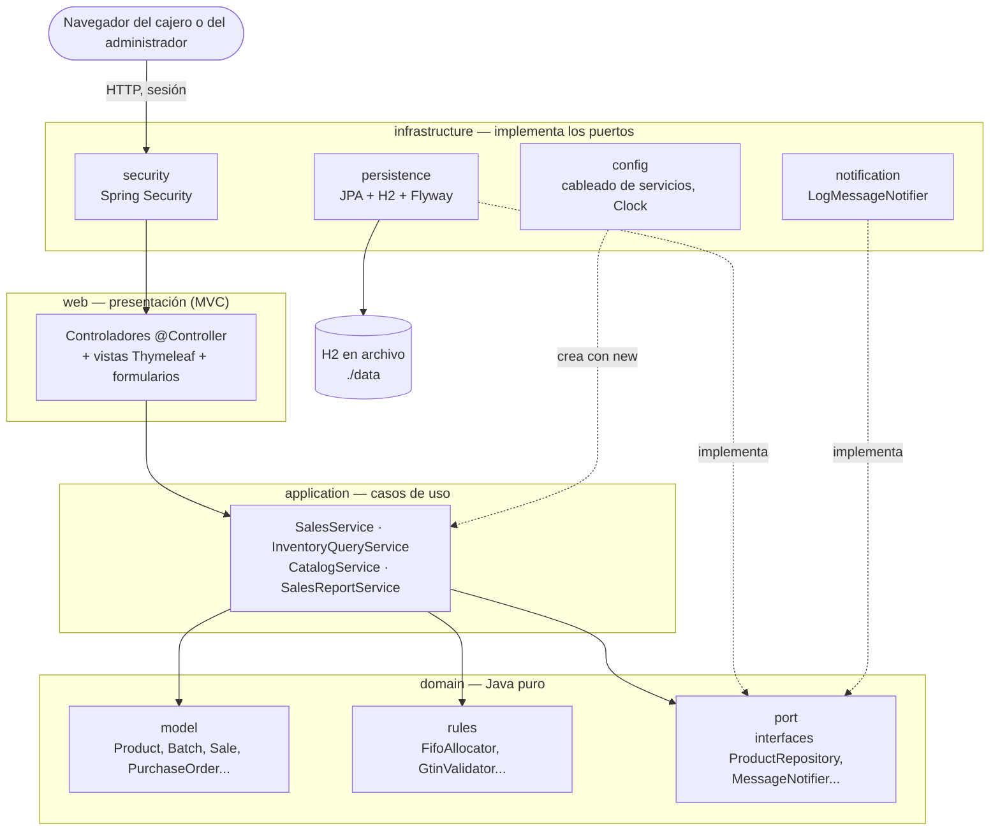
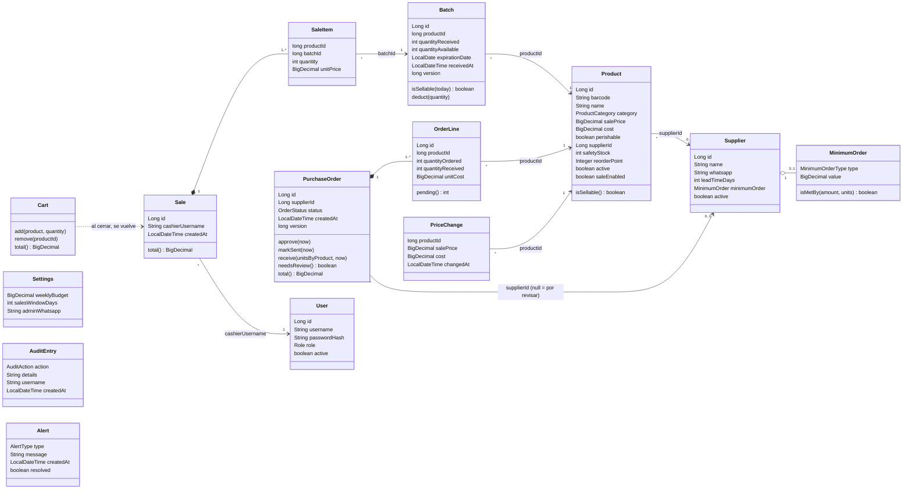
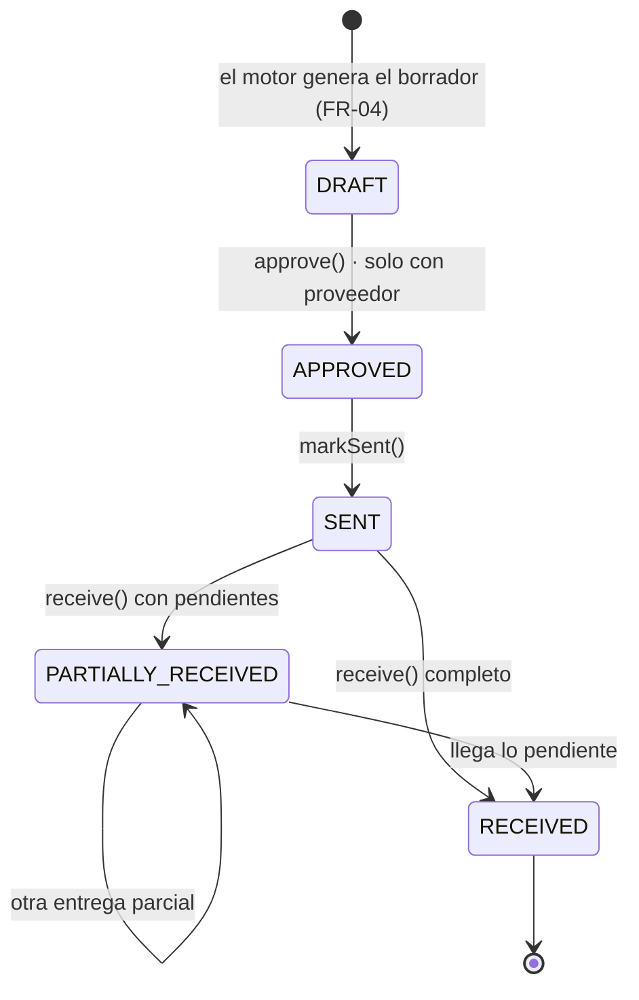
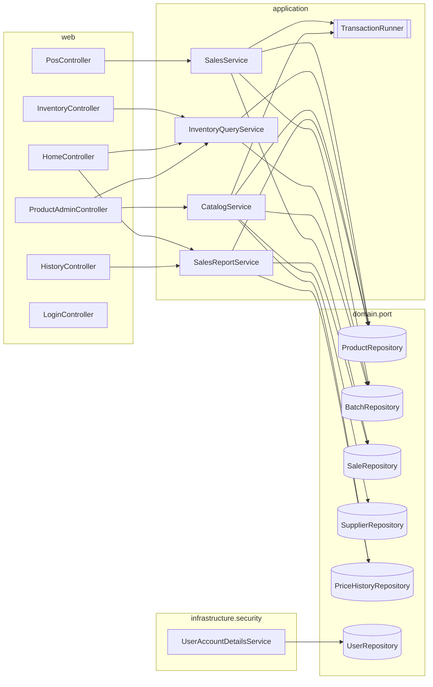
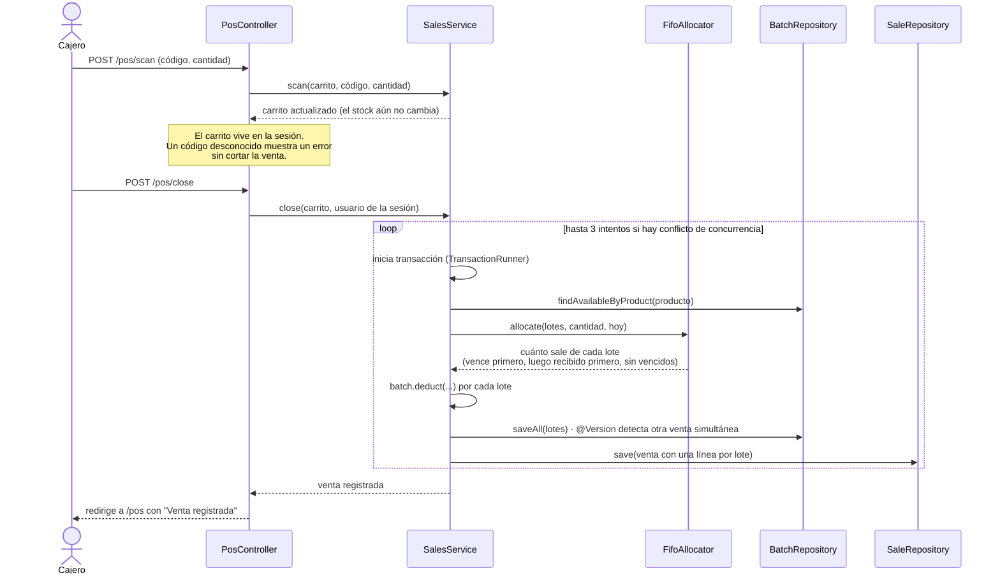

# Arquitectura de InventIQ

Documento de arquitectura de la Entrega 2 (tarea A11). Describe las **capas**, el **modelo de dominio** y
las **dependencias entre componentes** del código actual, y cómo se verifica que el código las respete.

| | |
|---|---|
| **Producto** | InventIQ: motor de decisiones de inventario para tiendas pequeñas (un punto de venta) |
| **Versión del documento** | Entrega 2 · borrador del 17 de octubre de 2026, antes del día de integración |
| **Base** | Entrega 1, sección 3 (estilo en capas + MVC, diagramas de componentes y de despliegue) |
| **Diagramas** | En Mermaid; GitHub los muestra como imagen al abrir este archivo |

Las secciones 1 a 9 describen la arquitectura común y la escribió A. La sección 10 la completa cada letra
(B, C y D) con su módulo, según el reparto (B10, C9, D8).

---

## 1. Estilo y decisiones principales

InventIQ es un **monolito en capas con el patrón MVC**, como se definió en la Entrega 1: un repositorio, un
JAR y un proceso. Las vistas se renderizan en el servidor con Thymeleaf; no hay SPA ni API REST interna.

Dentro del monolito, el dominio sigue la idea de **puertos y adaptadores**: el dominio define interfaces
(puertos) para lo que necesita del exterior (guardar productos, enviar mensajes...) y la infraestructura
las implementa. Así las reglas de negocio no dependen de Spring ni de la base de datos y se pueden probar
solas, que es un criterio que el curso califica.

| Decisión | Por qué | Cómo se verifica |
|---|---|---|
| Reglas de negocio en `domain`, en Java puro | Probarlas sin servidor ni base (NFR-04) | ArchUnit falla si `domain` importa Spring, JPA o Hibernate |
| Dependencias en un solo sentido | Cambiar la base o la vista sin tocar las reglas | ArchUnit revisa el sentido entre capas |
| Dos modelos: dominio (`Product`) y persistencia (`ProductEntity`) | Las anotaciones JPA no entran al dominio | Mappers en `infrastructure/persistence/mapper` |
| Servicios sin `@Transactional` ni `@Service` | Armarlos a mano con fakes en las pruebas | Se crean con `new` en las clases `*Config` |
| "Hoy" siempre por un `Clock` inyectado | Fijar la fecha en las pruebas (vencimientos, ROP) | Zona de la tienda: `America/Bogota` (`ClockConfig`) |
| Una sola API externa (Twilio), detrás de `MessageNotifier` | Requisito del curso; la app sigue útil sin ella | En la Entrega 2 solo existe `LogMessageNotifier` |

### Cambios respecto a la Entrega 1

El diseño de la Entrega 1 se mantiene. Al programarlo se ajustaron nombres y algunos detalles:

- **Nombres en inglés en el código**: `VentasService` es `SalesService`, `NotificadorMensajes` es
  `MessageNotifier`, `ReabastecimientoService` será `ReplenishmentService` y `ComprasService` será
  `PurchasingService`.
- **`RepositorioInventario` se dividió en un puerto por agregado** (`ProductRepository`,
  `BatchRepository`, `SaleRepository`...), porque cada letra necesita consultas distintas.
- **Los servicios de aplicación son clases, no interfaces.** Cada uno tiene una sola implementación; los
  controladores dependen de la clase. La frontera que importa, la del dominio con el exterior, sí son
  interfaces (los puertos).
- **Twilio pasa a la Entrega 3.** FR-09 es de la Entrega 3, y sus credenciales exigirían variables de
  entorno, cosa que el curso no permite para arrancar.

---

## 2. Capas



Las flechas son dependencias de código: quién conoce a quién. Las flechas punteadas de la infraestructura
hacia los puertos indican que la infraestructura **implementa** interfaces del dominio. El dominio no
conoce ninguna otra capa.

| Capa | Paquete | Qué contiene | Qué no puede hacer |
|---|---|---|---|
| Presentación | `web` | Controladores, formularios (`*Form`), formato de vistas (`ViewFormat`, `Money`) y datos comunes de la plantilla (`NavigationAdvice`) | Tener reglas de negocio; usar `@RestController` |
| Aplicación | `application` | Casos de uso que orquestan dominio y puertos; `TransactionRunner` | Usar Spring, JPA o SQL directamente |
| Dominio | `domain` | Modelo, reglas, puertos y excepciones de negocio | Importar Spring, JPA, Hibernate o cualquier otra capa |
| Infraestructura | `infrastructure` | Persistencia, seguridad, notificaciones y cableado (`*Config`) | Ser usada por el dominio o la aplicación (solo a través de los puertos) |

Excepciones permitidas, también revisadas por ArchUnit: `web` puede leer clases del modelo de dominio para
mostrarlas, y `infrastructure.config` crea los servicios de `application`.

### Módulos de la Entrega 1 en el código

| Módulo (Entrega 1) | Letra | Paquetes |
|---|---|---|
| MOD-01 Seguridad y acceso | A | `infrastructure.security`, `web.auth` |
| MOD-02 POS e inventario | B | `application.sales`, `web.pos`, `web.inventory`, `domain.rules.FifoAllocator` |
| MOD-03 Motor de reabastecimiento | C | `application.replenishment`, `web.replenishment` (en construcción) |
| MOD-04 Vencimientos y precios | — | Entrega 3 (FR-07) |
| MOD-05 Compras y administración | D | `application.admin`, `application.purchasing`, `web.admin`, `web.purchasing` |
| MOD-06 Infraestructura y despliegue | A | `infrastructure.persistence`, `infrastructure.config`, `infrastructure.notification`, `db/migration` |

`application.reports` (historial y análisis de ventas) está en la Administración (D). Para la velocidad de ventas, C usa directamente el puerto `SaleRepository.findItemsSoldBetween`.

---

## 3. Modelo de dominio

### 3.1 Entidades y relaciones



**Cómo leerlo.**

- Las entidades se relacionan **por identificador** (`productId`, `supplierId`) y no por referencias de
  objeto. Cada agregado (un producto, un lote, una venta con sus líneas, un pedido con sus líneas) se
  carga y se guarda entero por su propio puerto, y una regla nunca recorre medio grafo de objetos sin
  querer.
- Los rombos marcan composición: las líneas de una venta o de un pedido no existen sin él.
- `Settings`, `AuditEntry` y `Alert` no se relacionan con las demás: son la configuración de la tienda y
  los registros de lo que pasó.

| Concepto | Qué representa | Detalle importante |
|---|---|---|
| `Product` | Producto del catálogo, identificado por su código de barras GTIN | `saleEnabled = false` pausa la venta sin sacarlo del inventario |
| `Batch` | Unidades recibidas juntas, con un mismo vencimiento | El código de barras **no** distingue lotes: la venta decide de cuál descontar (FIFO) |
| `Cart` | Venta en curso del cajero; vive en la sesión | No toca el stock hasta cerrar la venta |
| `Sale` / `SaleItem` | Venta cerrada | Una línea **por lote** descontado: si un producto salió de dos lotes, tiene dos líneas |
| `PurchaseOrder` / `OrderLine` | Pedido a un proveedor | Sin proveedor = pedido "por revisar" (US-01 esc. 2); no se puede aprobar |
| `PriceChange` | Precio de venta y costo vigentes desde una fecha | Permite calcular el margen de una venta pasada con el costo de ese día |
| `User` | Usuario con rol `ADMIN` o `CASHIER` | La contraseña llega ya cifrada (BCrypt); el dominio nunca la ve en claro |
| `Settings` | Parámetros de la tienda (FR-08) | Ventana de ventas de 30 días por defecto |
| `AuditEntry` / `Alert` | Auditoría (FR-11) y alertas al administrador | `username = null` en la auditoría = decisión automática del sistema |

Objetos de valor y enumeraciones: `NetContent` (contenido neto con su `ContentUnit`), `ProductCategory`,
`ExpirationStatus` (vencido, por vencer en 7 días o menos, vigente, sin vencimiento), `MinimumOrderType`,
`Role`, `AuditAction` y `AlertType`. `NewProduct` y `ProductData` son los datos de un producto por
registrar o editar, antes de validarlos.

### 3.2 Estados del pedido

Las transiciones válidas viven en `OrderStatus.nextStatuses()`, y `PurchaseOrder` las aplica. Un salto
inválido lanza `InvalidOrderTransitionException`, cuyo mensaje se muestra en español.



Solo un borrador (`DRAFT`) se puede editar, y no se puede recibir más de lo pendiente en cada línea.
Recibir mercancía actualiza las cantidades del pedido; crear los lotes en inventario le corresponde al
servicio de recepción (D6).

### 3.3 Reglas de negocio

Lo que el software decide en lugar de una persona, y lo que el curso califica:

| Regla | Clase | Requisito | Estado |
|---|---|---|---|
| Descontar del lote que vence primero, luego del recibido primero; excluir vencidos | `FifoAllocator` | FR-02, US-03 | Lista |
| Código de barras GTIN con dígito de verificación | `GtinValidator` | Alcance (productos con código estándar) | Lista |
| Validar un producto nuevo o editado, campo por campo | `NewProductValidator` | FR-08 | Lista |
| Costo y precio vigentes en cada fecha, y su variación | `PriceTimeline` | FR-11 (análisis) | Lista |
| Transiciones del pedido y recepción parcial | `OrderStatus`, `PurchaseOrder` | FR-04, FR-10, US-05 | Lista (modelo); falta el servicio (D) |
| ¿El pedido alcanza el mínimo del proveedor? | `MinimumOrder.isMetBy` | FR-05 | Base lista; la regla completa es de la Entrega 3 |
| Velocidad de ventas y punto de reorden | `SalesVelocityCalculator`, `ReorderPointCalculator` | FR-03 | En construcción (C) |
| Un borrador por proveedor, sin duplicar abiertos | `DraftOrderGrouper` | FR-04, US-01 | En construcción (C) |

### 3.4 Errores de negocio

Todas las excepciones de `domain.exception` heredan de `BusinessException`. Su mensaje está escrito para
el usuario, en español, y los controladores lo muestran tal cual en un mensaje flash. Por ejemplo:
`UnknownBarcodeException`, `InsufficientStockException`, `ProductNotForSaleException`,
`InvalidOrderTransitionException`, `OrderWithoutSupplierException` e `InvalidReceiptException`.

Los errores de programación (un argumento imposible) usan las excepciones estándar de Java y nunca llegan
al usuario como mensaje de negocio.

---

## 4. Dependencias entre componentes

### 4.1 Controladores, servicios y puertos



`LoginController` no depende de ningún servicio: solo muestra la página. Spring Security valida la
contraseña con `UserAccountDetailsService`, que lee los usuarios por el puerto `UserRepository`. Todos los
servicios reciben además un `Clock`.

| Servicio | Caso de uso | Puertos que usa |
|---|---|---|
| `SalesService` | Iniciar, escanear y cerrar una venta con FIFO (B) | `ProductRepository`, `BatchRepository`, `SaleRepository`, `TransactionRunner` |
| `InventoryQueryService` | Stock por producto y lotes en orden FIFO (B) | `ProductRepository`, `BatchRepository` |
| `CatalogService` | Registrar, editar y pausar productos (D) | `ProductRepository`, `BatchRepository`, `SupplierRepository`, `PriceHistoryRepository`, `TransactionRunner` |
| `SalesReportService` | Historial de ventas, precios y márgenes | `SaleRepository`, `ProductRepository`, `PriceHistoryRepository` |

### 4.2 Puertos y adaptadores

| Puerto (dominio) | Adaptador (infraestructura) | Estado |
|---|---|---|
| `ProductRepository` | `ProductRepositoryAdapter` | Implementado |
| `BatchRepository` | `BatchRepositoryAdapter` | Implementado, con bloqueo optimista |
| `SaleRepository` | `SaleRepositoryAdapter` | Implementado |
| `SupplierRepository` | `SupplierRepositoryAdapter` | Implementado (lectura); D2/D4 agregan la escritura |
| `PriceHistoryRepository` | `PriceHistoryRepositoryAdapter` | Implementado |
| `UserRepository` | `UserRepositoryAdapter` | Implementado |
| `MessageNotifier` | `LogMessageNotifier` | Implementado (escribe en el log); Twilio en la Entrega 3 |
| `PurchaseOrderRepository` | — | Pendiente (D2) |
| `SettingsRepository` | — | Pendiente (D2) |
| `AuditLogRepository` | — | Pendiente (D2) |
| `AlertRepository` | — | Pendiente (D2) |

Cada adaptador de persistencia sigue el mismo patrón: una entidad JPA (`ProductEntity`), un repositorio de
Spring Data (`ProductJpaRepository`) y un mapper (`ProductMapper`) que convierte entre la entidad y el
modelo de dominio. En las pruebas de `application`, cada puerto tiene un fake en memoria
(`test/.../fakes`), y los servicios se prueban sin Spring.

### 4.3 Cableado

Los servicios de `application` no llevan anotaciones de Spring. Cada letra los crea en su propia clase de
configuración, para no editar el mismo archivo:

| Clase | Crea |
|---|---|
| `SalesConfig` | `SalesService`, `InventoryQueryService` |
| `AdminConfig` | `CatalogService` |
| `ReportsConfig` | `SalesReportService` |
| `ClockConfig` | `Clock` con la zona `America/Bogota` |
| `SecurityConfig` | Reglas de acceso, `PasswordEncoder` (BCrypt) y `UserAccountDetailsService` |

Las transacciones pasan por `TransactionRunner` (en producción, `SpringTransactionRunner`). Así un caso de
uso que guarda varias cosas lo hace todo o nada, sin poner `@Transactional` en la aplicación.

---

## 5. Flujo de punta a punta: una venta con FIFO

La regla que la Entrega 2 resuelve de punta a punta (FR-02, US-03). El cajero escanea con un lector USB
que funciona como teclado o escribe el código, y al cerrar la venta el stock se descuenta del lote que
vence primero.



Si dos cajas venden el mismo lote al mismo tiempo, el bloqueo optimista (`@Version` en `Batch`) hace que
una de las dos transacciones falle. El servicio la repite con los datos nuevos (hasta 3 veces), y el stock
nunca queda negativo: la base también lo impide con una restricción `CHECK`. `SalesConcurrencyTest` lo
prueba con dos hilos.

---

## 6. Seguridad

Spring Security con sesión, contraseñas en BCrypt y protección CSRF en todos los formularios (FR-01,
NFR-03).

| Ruta | Quién entra |
|---|---|
| `/login`, `/error`, `/css/**`, `/js/**`, `/webjars/**` | Cualquiera, sin sesión |
| `/pos/**` (Ventas) | Administrador y cajero |
| `/` (Inicio) | Cualquier usuario con sesión; al cajero lo redirige a Ventas |
| **Cualquier otra ruta** | Solo el administrador; el cajero recibe 403 |

La última regla hace que las pantallas nuevas nazcan protegidas: C y D no tienen que acordarse de
protegerlas. `SecurityRoutesTest` lee todas las rutas registradas en Spring y comprueba las reglas en cada
una (sin sesión, cajero, administrador y POST sin token CSRF). Una ruta nueva queda probada sin editar la
prueba.

---

## 7. Persistencia

- **Base**: H2 embebida en archivo (`./data/inventiq`, o `./data/inventiq-demo` con el perfil `demo`).
  Se crea sola al arrancar; no hay que instalar nada.
- **Esquema**: lo maneja solo Flyway, con migraciones versionadas por fecha y hora
  (`V20261017_1200__esquema_inicial.sql`) para que dos personas no choquen. Hibernate solo valida que las
  entidades coincidan con las tablas (`ddl-auto=validate`), y una migración fusionada nunca se edita.
- **Tablas**: `app_user`, `supplier`, `product`, `batch`, `sale`, `sale_item`, `purchase_order`,
  `order_line`, `settings`, `audit_log`, `alert` y `price_history`.
- **Datos de demostración**: solo con el perfil `demo` (`db/demo`). Incluyen 90 días de ventas generados
  por una migración en Java con semilla fija, para que el ROP tenga historial real que analizar.
- **Concurrencia**: `@Version` (bloqueo optimista) en `product` y `batch`, y restricciones `CHECK` que
  impiden stock negativo.

---

## 8. Calidad verificable

Las reglas de la arquitectura no dependen de la buena voluntad: el build las hace cumplir en cada pull
request.

| Qué se exige | Cómo se hace cumplir |
|---|---|
| El dominio no importa Spring, JPA ni Hibernate | `LayerDependencyTest` (ArchUnit) |
| Las capas dependen solo en el sentido acordado | `LayerDependencyTest` (ArchUnit) |
| Cobertura de líneas del dominio ≥ 80 % (NFR-04) | JaCoCo en `./mvnw verify`; el build falla si baja. Hoy: **99,4 %** |
| Reglas de negocio probadas sin servidor ni base | Pruebas de `domain` y `application` con fakes en memoria |
| Persistencia contra el esquema real | `@DataJpaTest` con las migraciones de Flyway |
| El cajero no entra a administración | `SecurityRoutesTest` sobre todas las rutas |
| El JAR arranca solo, con Java 21 | `scripts/smoke-test-jar.sh` en el CI |

Hoy hay **282 pruebas**. GitHub Actions corre `./mvnw verify` y la prueba de humo del JAR en cada pull
request, y publica una tabla de cobertura por capa en el resumen de la corrida.

---

## 9. Despliegue

Se mantiene el diagrama de despliegue de la Entrega 1:

- un solo proceso en la JVM (Java 21) ejecuta el JAR, que trae el servidor web embebido (Tomcat);
- la base H2 corre dentro del mismo proceso y se accede por JDBC sin red;
- el cajero y el administrador solo usan un navegador.

```bash
./mvnw package
java -jar target/inventiq-0.1.0-SNAPSHOT.jar                                 # base normal
java -jar target/inventiq-0.1.0-SNAPSHOT.jar --spring.profiles.active=demo   # con datos demo
```

En la Entrega 2 no hay Twilio: los mensajes se escriben en el log, así que la app arranca sin credenciales
ni variables de entorno (NFR-05).

---

## 10. Secciones por módulo

Cada letra completa su sección antes del 3 de noviembre (reparto: B10, C9, D8), y otra letra la revisa.
Lo que aquí se indica es lo mínimo que debe tener cada una.

### 10.1 Parte A: base, seguridad e infraestructura

Las secciones 1 a 9 de este documento, en particular la 6 (seguridad), la 7 (persistencia), la 8 (calidad)
y la 9 (despliegue).

### 10.2 Parte B: POS e inventario (B10)

> **Pendiente de B.** Debe incluir el módulo POS, el diagrama de secuencia de una venta (puede partir del
> de la sección 5), capturas y el reporte de pruebas. Material ya escrito:
> [`desarrollo/parte-b-pos-inventario.md`](desarrollo/parte-b-pos-inventario.md).

### 10.3 Parte C: motor de reabastecimiento (C9)

> **Pendiente de C.** Debe incluir el algoritmo del ROP con un ejemplo numérico, las pruebas y la medición
> de rendimiento con 1.000 productos (NFR-01: menos de 1,5 s).

### 10.4 Parte D: compras y administración (D8)

> **Pendiente de D.** Debe incluir la administración (productos, proveedores, parámetros), el flujo de
> pedidos con sus estados (puede partir de la sección 3.2) y la recepción, con capturas.

---

## Referencias

- Entrega 1: requerimientos y arquitectura (`docs/Deliverable 1 - Requirements and Architecture EN.docx (1).pdf`).
- Reparto de la Entrega 2 (`docs/InventIQ – Reparto de la Entrega 2.pdf`).
- Decisiones de diseño tomadas durante la Entrega 2 y pendientes de revisión:
  [`desarrollo/decisiones-pendientes.md`](desarrollo/decisiones-pendientes.md).
- Cómo levantar y probar la aplicación: [`README.md`](../README.md).
